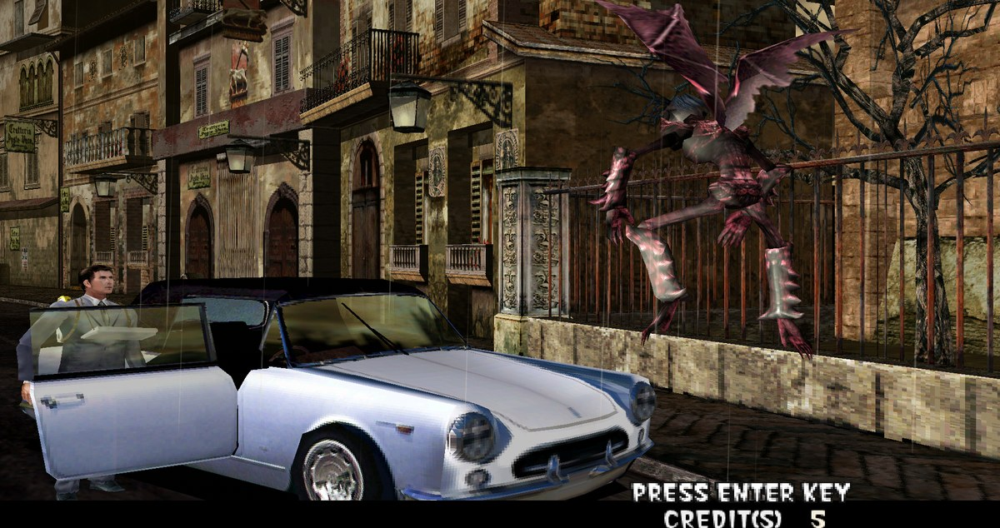

# The Typing of the Dead: HD / widescreen resolution



The 2000 PC port of **The Typing of the Dead** (`Tod_e.exe`) is hard-wired to
640x480 with no resolution option anywhere. This ASI plugin lets it run at
1920x1200 (or any size you want) and scales the HUD with it.

## Features

* **Any resolution:** the game window, back buffer and video-mode list are all
  rewritten in memory. Nothing on disk is modified.
* **HUD included:** the 2D layer (health bar, `PERFECT` text, ranks, prompts,
  rain) is screen-space 640x480 and would otherwise sit stuck in the top-left
  corner. It is rescaled to fill the screen.
* **Config file:** change resolution with a text file, no rebuild.
* **No binary patching:** the exe is untouched, so it is trivially reversible.

Works on the original exe:

| | |
|---|---|
| File | `Tod_e.exe` |
| Size | 2,048,000 bytes |
| MD5 | `d6fd9e2eafb90871196d66881688b738` |

## Requirements

* **The Typing of the Dead** (Sega, 2000), `Tod_e.exe`
* [**Ultimate ASI Loader**](https://github.com/ThirteenAG/Ultimate-ASI-Loader/releases)
  (the Universal `dinput8.dll` build)

The game imports `DINPUT.dll`, so the loader goes next to `Tod_e.exe` renamed to
**`dinput.dll`**. The Universal loader exports the `dinput` entry points and
forwards them to the system DLL, so input keeps working.

## Install

### 1. Put the loader in the game folder

Download Ultimate ASI Loader, copy `dinput8.dll` into the game folder and rename
it to `dinput.dll`:

```
The Typing of the Dead\
    Tod_e.exe
    dinput.dll          <- Ultimate ASI Loader (renamed)
    tod_scale.asi
    tod_scale.ini
```

### 2. Copy the plugin

Download `tod_scale.asi` and `tod_scale.ini` from the releases page (or build
them from source) and drop them next to `Tod_e.exe`, alongside the loader, then
launch the game normally.

## Configuration

`tod_scale.ini` (next to the plugin):

```ini
[TodScale]
width=1920
height=1200
source_width=640
source_height=480
patch_modes=1
write_globals=1
hud_scale=1       ; 0 = off, 1 = stretch to fill, 2 = uniform (keeps sprites square)
hud_scale_x=0     ; explicit multipliers, 0 = auto
hud_scale_y=0
```

Environment overrides: `TOD_SCALE_WIDTH`, `TOD_SCALE_HEIGHT`,
`TOD_SCALE_SOURCE_WIDTH`, `TOD_SCALE_SOURCE_HEIGHT`, `TOD_SCALE_PATCH_MODES`,
`TOD_SCALE_WRITE_GLOBALS`, `TOD_SCALE_HUD`, `TOD_SCALE_HUD_SCALE_X`,
`TOD_SCALE_HUD_SCALE_Y`.

`source_width` / `source_height` are the game's built-in 640x480 and normally
never need changing. `hud_scale=2` is useful if the stretched HUD text bothers
you, it scales uniformly by the height ratio and centres the layer.

The log is written to `tod_scale.log` next to the game.

## How it works

Everything is done in memory from `DllMain`, which runs before the game's
`WinMain` (the loader is pulled in during static import resolution):

1. **Display setup** (`Tod_e.exe+0x4bddb0`) writes the screen size into two
   globals:
   ```
   0x4bde32  mov dword [0x8490ac], 640
   0x4bde3c  mov dword [0x8490b0], 480
   ```
   Both the window and the D3DX7 context are built from those. The plugin
   signature-scans for the pair, rewrites the immediates and the globals.

2. **Video-mode list** (`0x5eb6c8`), 16 entries of
   `DWORD width, height, bpp, fullscreen`, holds only 320x240 / 640x480. Every
   640x480 entry is rewritten so in-game mode changes agree.

3. **2D layer**. The HUD is drawn with pre-transformed screen-space vertices
   (`FVF 0x1c4` = `XYZRHW|DIFFUSE|SPECULAR|TEX1`) at 640x480 pixel coordinates,
   so it ignores the viewport. The plugin waits for the `IDirect3DDevice7`
   pointer (`0x8491ec`), hooks its `DrawPrimitive` slot (vtable index 25) and
   scales the `x`/`y` of every `XYZRHW` vertex by `target/source`.

Key addresses (image base `0x400000`):

| what | VA |
|---|---|
| display setup routine | `0x4bddb0` |
| screen width / height | `0x8490ac` / `0x8490b0` |
| bit depth / fullscreen | `0x8490b8` / `0x8490b4` |
| video-mode list | `0x5eb6c8` |
| mode-index setter / `SetDisplayMode` | `0x4bdc40` / `0x4bd6a0` |
| D3DX context create | `0x4bcec0` |
| per-frame projection matrix | `0x812738` |
| IDirect3DDevice7 pointer | `0x8491ec` |
| 2D `DrawPrimitive` wrapper (FVF 0x1c4) | `0x4bda80` |

If the exe is ever re-linked the signatures simply won't match, the plugin logs
it and leaves the game alone, so it fails safe instead of crashing.

## Build

```bash
bash build.sh      # -> tod_scale.asi (32-bit, i686-w64-mingw32-gcc)
```